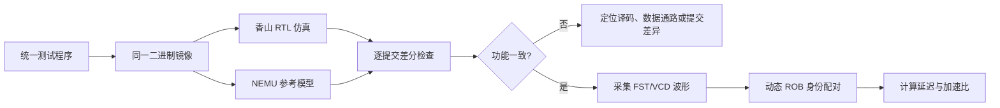

# vdot 阶段三：RTL–NEMU 协同验证方针与性能分析报告

## 1. 报告目的

本报告面向“香山”昆明湖 V2 平台上的自定义 `vdot.vv` 指令，说明阶段三采用的 RTL–NEMU 协同验证方针，并对 Baseline 向量组合指令与 vdot 专用加速单元进行延迟和吞吐对比。

本报告采用三层性能口径：

1. **功能单元执行链延迟**：观察专用乘法归约数据通路本身的收益。
2. **单组完整计算段延迟**：观察一组8元素点积从 Dispatch 到 ROB Commit 的端到端延迟。
3. **连续64组完整函数吞吐**：观察真实循环中加载、计算、写回和循环控制共同作用下的稳定性能，作为阶段三主加速比。

最终推荐结论为：连续64组点积的 Baseline 中位数为 **828周期**，vdot 中位数为 **510周期**，完整函数加速比为 **1.624×**，延迟降低 **38.41%**。

---

## 2. 测试对象与语义范围

### 2.1 赛题参数

| 参数 | 设置 |
|---|---|
| 目标平台 | XiangShan 昆明湖 V2 |
| 指令 | 自定义 `vdot.vv` |
| SEW | 8 |
| VLEN | 128 bit |
| 输入类型 | 有符号 `int8` |
| 每条指令参与点积的元素数 | 8 |
| 有效结果 | `vd[0]` 中的32位有符号点积和 |

自定义指令的计算语义为：

$$
result=\sum_{i=0}^{7} sign\_extend(vs1[i])\times sign\_extend(vs2[i])
$$

结果写入目标向量寄存器的第一个元素：

$$
vd[0]=result
$$

vdot RTL 同时将高96位清零。

### 2.2 本次性能比较的等价范围

连续性能测试将每组点积的低32位结果保存为 `int32_t`，Baseline 和 vdot 的所有保存结果完全相同。因此本报告的应用性能结论对应“产生相同32位有符号点积结果”的计算任务。

原 Baseline 使用 tail agnostic 配置时，没有保证目标向量高96位为零。因此：

- **低32位点积结果等价**：已通过全部功能检查和 NEMU 差分验证。
- **完整128位寄存器等价**：当前 Baseline 不保证高96位清零。
- 如果评审要求完整128位输出严格等价，应在 Baseline 中加入清零或 tail-undisturbed 处理，并重新测量。

---

## 3. RTL–NEMU 协同验证方针

### 3.1 总体原则

协同验证遵循“**先证明功能正确，再分析性能收益**”的顺序。NEMU 作为指令语义参考模型，RTL 作为被测实现；两者执行相同测试镜像，并在每条提交指令处进行状态对比。



### 3.2 各部分职责

| 部分 | 职责 | 验证重点 |
|---|---|---|
| 测试程序 | 生成确定性输入并检查结果 | 正数、负数、混合符号、边界值、连续多组 |
| NEMU | 实现 `vdot.vv` 的参考语义 | 符号扩展、8项乘法、归约、结果写回 |
| XiangShan RTL | 执行自定义指令 | 译码、操作数读取、专用乘法归约树、写回、提交 |
| Difftest | 比较 RTL 与参考模型状态 | 提交顺序、寄存器结果、异常状态 |
| 波形分析脚本 | 提取微架构事件 | Dispatch、FU 输入/输出、ROB Commit、ROB 编号 |
| 性能脚本 | 计算多轮统计值 | 每轮周期、中位数、每组周期、加速比 |

### 3.3 公平对照约束

Baseline 与 vdot 必须满足以下条件：

1. 使用相同输入、输出布局和组数。
2. 使用相同 C 驱动、`main`、数据地址、对齐方式和打印流程。
3. 两份程序只允许计算内核不同，其余代码和数据布局保持一致。
4. 使用相同 `emu`、NEMU 参考模型、`seed=0`、128 MB 仿真内存。
5. 初始化、打印和结果检查不能计入点积计算区间。
6. 性能比较必须建立在功能结果通过之后。
7. 单组波形比较采用相同微架构边界；批量测试采用相同函数边界。

连续64组测试中，两份二进制只在固定的256字节计算内核内不同，内核外代码和地址保持一致。

### 3.4 功能测试方针

独立功能测试覆盖以下数据类型：

| 测试类型 | 目的 |
|---|---|
| 正数 | 验证基本乘法和归约 |
| 负数 | 验证有符号扩展 |
| 混合符号 | 验证正负积累加 |
| 边界值 | 验证 `-128`、`127` 等极值 |
| 连续64组 | 验证循环执行、地址更新和持续写回 |

四类输入重复两轮时，Baseline 与 vdot 的低32位结果均通过检查；连续测试中，预热64组加五轮正式测试，共检查384个结果，两种实现均为 **384/384 PASS**，且都以 **HIT GOOD TRAP** 结束。

---

## 4. 波形延迟取点方法

### 4.1 两个 L 的统一定义

单组完整计算段使用相同的起点和终点：

- **起点 A**：首条计算指令在 Dispatch 阶段满足 `valid && ready`。
- **终点 B**：最终结果指令在 ROB 满足 `isCommit && commitValid`。

延迟定义为：

$$
L=cycle(B)-cycle(A)
$$

加速比定义为：

$$
Speedup=\frac{L_{Baseline}}{L_{vdot}}
$$

不能只看到相同 PC 就直接相减。循环、回滚和 ROB 指针复用可能导致同一 PC 多次出现，因此分析脚本同时匹配：

- 指令 PC；
- ROB flag；
- ROB value；
- 动态执行时间顺序；
- 最终提交事件。

### 4.2 Baseline 单组波形

Baseline 的点积组合序列为：

```asm
vwmul.vv    v4, v1, v2
vsetivli    zero, 1, e32, m1, ta, ma
vmv.v.i     v6, 0
vsetivli    zero, 8, e16, m1, ta, ma
vwredsum.vs v8, v4, v6
```

波形取点：

| 事件 | 周期 |
|---|---:|
| 首条计算指令 Dispatch | 10667 |
| 最终结果指令 ROB Commit | 10758 |
| 完整计算段延迟 | **91周期** |

$$
L_{Baseline}=10758-10667=91
$$

对应波形文件：[`baseline_latency.gtkw`](./baseline_latency.gtkw)。

### 4.3 vdot 单组波形

vdot 使用单条自定义编码进入 Vimac 专用数据通路：

```asm
.word 0xe61101d7
```

波形取点：

| 事件 | 周期 |
|---|---:|
| vdot Dispatch | 10955 |
| vdot ROB Commit | 11030 |
| 完整计算段延迟 | **75周期** |

$$
L_{vdot}=11030-10955=75
$$

对应波形文件：[`vdot_latency.gtkw`](./vdot_latency.gtkw)。

### 4.4 单组完整延迟加速比

$$
Speedup_{single}=\frac{91}{75}=1.213\times
$$

$$
Reduction_{single}=\left(1-\frac{75}{91}\right)\times100\%=17.58\%
$$

因此，原始单组测试中，vdot 将完整计算段从91周期降低至75周期，加速 **1.213×**，延迟降低 **17.58%**。

---

## 5. 功能单元执行链分析

为了分离专用计算单元本身的收益，进一步测量：

- 起点：首次乘法微操作进入功能单元；
- 终点：最终点积和从功能单元输出。

| 实现 | 执行链起点 | 执行链终点 | 执行链延迟 |
|---|---:|---:|---:|
| Baseline | 10740 | 10756 | **16周期** |
| vdot | 11026 | 11028 | **2周期** |

$$
Speedup_{FU}=\frac{16}{2}=8.000\times
$$

vdot 的并行乘法和归约树显著缩短了乘法归约链，但完整任务还包含向量加载、操作数等待、Dispatch、写回和 ROB 提交，所以 **8×是功能单元局部加速，不能作为完整应用加速比**。

---

## 6. 多输入波形结果与缓存影响

四类输入分别进行两轮测试。第一轮和第二轮处于同一进程中，没有在每项测试前清空缓存或重置预测器。

| 轮次 | 输入 | Baseline L | vdot L | 加速比 |
|---:|---|---:|---:|---:|
| 1 | 正数 | 89 | 75 | 1.187× |
| 1 | 负数 | 93 | 50 | 1.860× |
| 1 | 混合符号 | 92 | 39 | 2.359× |
| 1 | 边界值 | 92 | 39 | 2.359× |
| 2 | 正数 | 43 | 29 | 1.483× |
| 2 | 负数 | 43 | 29 | 1.483× |
| 2 | 混合符号 | 43 | 29 | 1.483× |
| 2 | 边界值 | 47 | 29 | 1.621× |

波形中的 DCache 响应表明：

- 第一轮四组加载均出现 `miss=1`；
- 第二轮四组加载均为 `miss=0`；
- vdot 正数样本的 Dispatch 到功能单元输入等待由71周期降至25周期；
- Baseline 同样出现71周期到25周期的变化。

因此，两轮差异主要来自共同的向量加载命中状态，而不是 vdot Dispatch 本身突然变快，也不能解释为负数或混合符号数据计算更快。

单个样本容易受到缓存、分支预测和流水线状态影响，因此最终应用结论采用连续多组、多轮中位数。

完整四组数据见 [`four_cases/results.md`](./four_cases/results.md)。

---

## 7. 连续64组吞吐测试

### 7.1 测试设计

连续测试保持每组长度为8个 `int8` 元素，只增加独立向量组数：

| 项目 | 设置 |
|---|---:|
| 每组元素数 | 8 |
| 每轮组数 | 64 |
| 不计时预热 | 1轮 |
| 正式测量 | 5轮 |
| 每种实现检查结果数 | 384 |

计时区间包括：

- 函数调用；
- 每组两次向量加载；
- 点积或乘法归约组合；
- 32位结果写回；
- 输入、输出指针更新；
- 循环分支。

不包括输入初始化、结果打印和最终检查。

### 7.2 五轮 mcycle 数据

| 轮次 | Baseline | vdot | 加速比 |
|---:|---:|---:|---:|
| 1 | 885 | 566 | 1.564× |
| 2 | 808 | 500 | 1.616× |
| 3 | 829 | 511 | 1.622× |
| 4 | 810 | 495 | 1.636× |
| 5 | 828 | 510 | 1.624× |

五轮统计值：

| 指标 | Baseline | vdot |
|---|---:|---:|
| 中位数 | **828周期** | **510周期** |
| 平均值 | 832周期 | 516.4周期 |
| 中位数每组周期 | **12.938** | **7.969** |

### 7.3 连续计算主加速比

$$
Speedup_{batch}=\frac{828}{510}=1.624\times
$$

$$
Reduction_{batch}=\left(1-\frac{510}{828}\right)\times100\%=38.41\%
$$

因此，连续64组完整点积函数的主加速比为 **1.624×**，延迟降低 **38.41%**。

### 7.4 波形交叉检查

批量波形采用“每次批处理第一条 `vsetivli` Dispatch → 循环结束标记 ROB Commit”的边界。稳定测量轮次为：

| 调用 | Baseline | vdot | 加速比 |
|---:|---:|---:|---:|
| 2 | 817 | 500 | 1.634× |
| 3 | 817 | 500 | 1.634× |
| 4 | 817 | 499 | 1.637× |
| 5 | 818 | 498 | 1.643× |

波形稳态结果约为 **1.63×**，与 `mcycle` 中位数 **1.624×** 一致，说明结论不依赖单一计时方法。

完整连续测试数据见 [`continuous_groups/results.md`](./continuous_groups/results.md) 和 [`continuous_groups/measurements.json`](./continuous_groups/measurements.json)。

---

## 8. 综合性能结论

| 层次 | Baseline | vdot | 加速比 | 适用解释 |
|---|---:|---:|---:|---|
| 功能单元乘法归约链 | 16周期 | 2周期 | **8.000×** | 专用硬件局部收益 |
| 原始单组 Dispatch→Commit | 91周期 | 75周期 | **1.213×** | 单组完整计算段 |
| 连续64组完整函数中位数 | 828周期 | 510周期 | **1.624×** | 阶段三主应用结论 |

推荐在答辩和报告中使用以下表述：

> 在 SEW=8、VLEN=128、每条指令处理8个有符号 int8 元素的条件下，vdot 专用单元将乘法归约执行链从16周期缩短到2周期，局部加速8倍。考虑向量加载、等待、写回和循环控制后，连续64组点积的完整函数中位数由828周期降低到510周期，应用级加速比为1.624倍，延迟降低38.41%。Baseline 与 vdot 均通过384项结果检查、NEMU差分验证和 GOOD TRAP。

不建议将“8×”单独写成整个程序加速比，因为它不包含加载和流水线开销。

---

## 9. 结果可信度与限制

### 9.1 已控制因素

- 相同测试驱动和输入数据；
- 相同数据地址、对齐和组数；
- 相同仿真器、参考模型、随机种子和内存设置；
- 相同计时边界；
- NEMU 差分验证开启；
- 功能通过后才统计性能；
- `mcycle` 与波形两种计时方式交叉检查；
- 多轮测试采用中位数，降低单轮流水线波动影响。

### 9.2 当前限制

1. 性能任务比较的是相同的低32位有符号点积结果；原 Baseline 的高96位未保证清零。
2. 连续64组数据约1 KB，主要反映缓存驻留后的向量点积吞吐，不代表超过缓存容量的流式访存性能。
3. 仿真结果代表当前 RTL、当前参数和当前时序配置，不直接等同于流片后的最高工作频率或功耗收益。
4. `cycleCnt` 覆盖启动、打印和退出流程，不能作为点积加速比；本报告只使用计算区间周期。

### 9.3 后续可选测试

如需进一步提高报告完整性，可以增加：

- 语义完全等价的高96位清零 Baseline；
- 超过一级数据缓存容量的连续流式测试；
- 不同组数，例如16、64、256、1024组的扩展曲线；
- 功能单元连续接收间隔，用于区分 latency 与 throughput；
- 综合后的面积、频率和功耗数据，用于计算性能面积比和能效收益。

---

## 10. 复现方法与证据文件

### 10.1 单组延迟证据

- [`latency_evidence.json`](./latency_evidence.json)
- [`baseline_latency.gtkw`](./baseline_latency.gtkw)
- [`vdot_latency.gtkw`](./vdot_latency.gtkw)
- [`latency_report.md`](./latency_report.md)

### 10.2 四类输入验证

- [`four_cases/results.md`](./four_cases/results.md)
- [`four_cases/measurements.json`](./four_cases/measurements.json)
- `four_cases/wave_views/` 中的16个独立波形视图

### 10.3 连续64组测试

- [`continuous_groups/batch_test.c`](./continuous_groups/batch_test.c)
- [`continuous_groups/batch_kernel.S`](./continuous_groups/batch_kernel.S)
- [`continuous_groups/measurements.json`](./continuous_groups/measurements.json)
- [`continuous_groups/baseline/simulation.log`](./continuous_groups/baseline/simulation.log)
- [`continuous_groups/vdot/simulation.log`](./continuous_groups/vdot/simulation.log)

复现命令：

```bash
python3 outputs/continuous_groups/build.py
python3 outputs/continuous_groups/run.py
python3 outputs/continuous_groups/report.py
```

### 10.4 录屏材料

- [`recording/vdot_waveform_performance.mp4`](./recording/vdot_waveform_performance.mp4)
- [`recording/narration.md`](./recording/narration.md)
- [`recording/thumbnail.png`](./recording/thumbnail.png)

所有新增测试、分析脚本、报告和录屏均保存在独立工作目录中，没有修改原 XiangShan 或 nexus-am 工程文件。

---

## 11. 提交前检查清单

- [ ] 报告中明确写出 `SEW=8`、`VLEN=128`、每条 vdot 处理8个 `int8` 元素。
- [ ] Baseline 和 vdot 使用相同输入、组数和计时边界。
- [ ] 附上 RTL–NEMU 差分验证与 GOOD TRAP 证据。
- [ ] 将 **1.624×** 写为连续点积主加速比。
- [ ] 将 **8×** 明确标注为功能单元执行链局部加速。
- [ ] 不使用完整程序 `cycleCnt` 代替点积计算区间周期。
- [ ] 明确当前性能等价范围为低32位有符号结果。
- [ ] 如评审要求完整128位严格等价，先修正 Baseline 高96位清零并重新测量。
